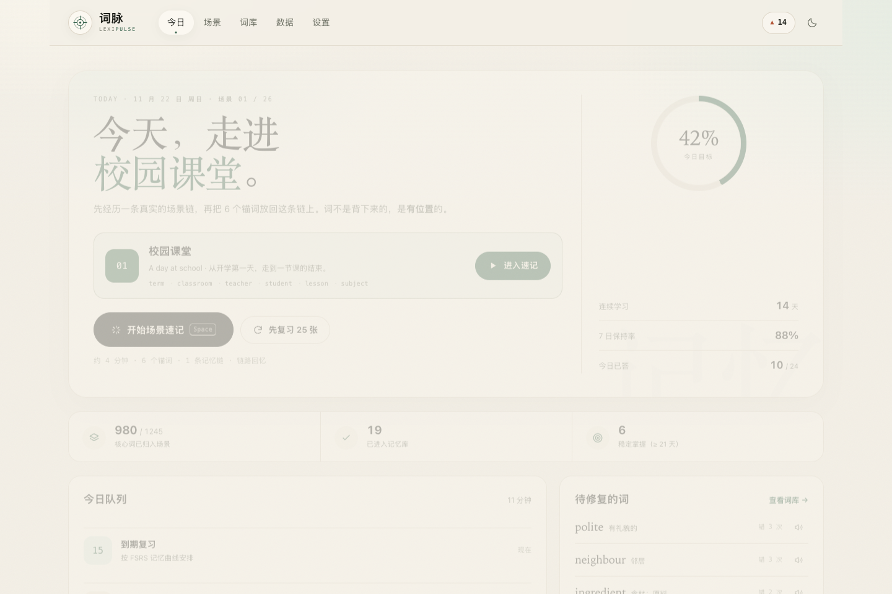
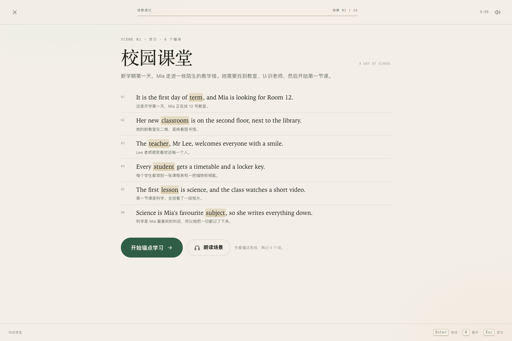
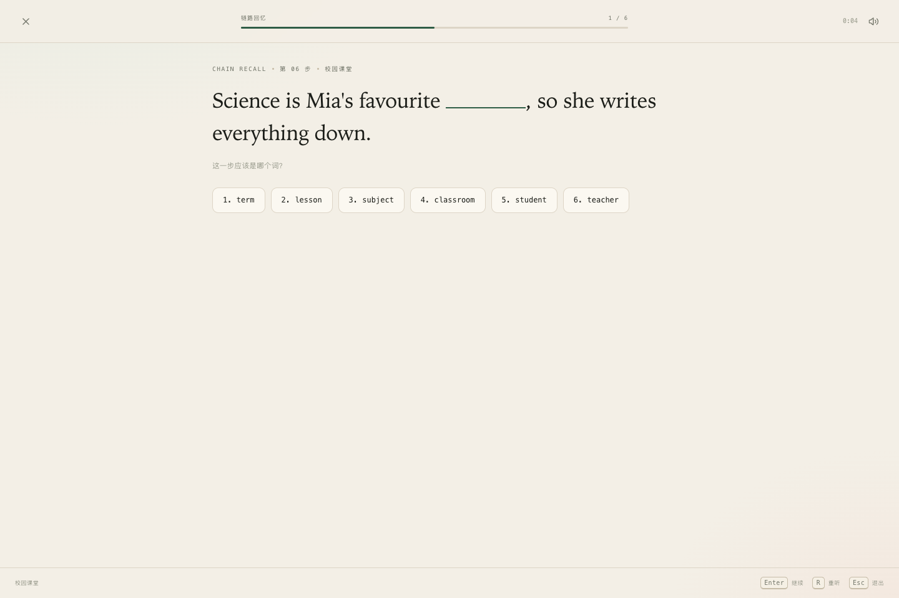
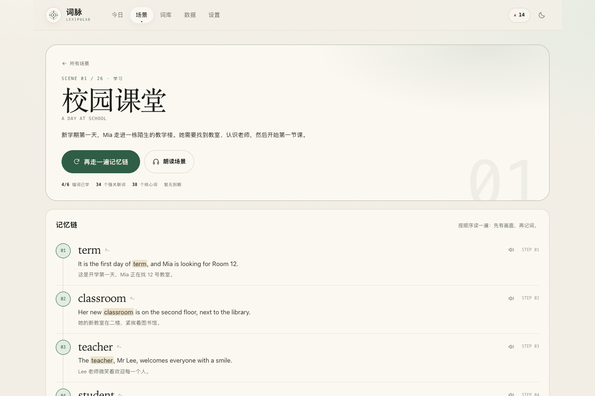

# 词脉 · PET 场景记忆引擎

> 不是把 1,245 个词背一遍，而是把它们放回 **26 个真实场景**，用一条「记忆链」串起来，再交给间隔复习守住。

词脉是一个纯前端、本地优先的 PET 核心词汇学习 Web 应用。它把「场景关系」放在第一位：每个场景先给你一段有顺序的经历，再让 6 个锚词落在这段经历的固定位置上；随后通过链路回忆、搭配/对比和 FSRS-6 间隔复习，把「场景里记得」变成「随时想得起」。



## 为什么是场景，而不是词表？

记不住的核心原因通常不是「不熟」，而是 **没有挂载点**。一个孤立的 `luggage` 很难被提取；但「值机 → 托运行李 → 拿登机牌 → 过海关 → 登机口」这条经历，会在你需要时把词一起带出来。

词脉把记忆过程拆成 4 步：

1. **场景锚定（Anchor）**：6 个词按因果/时间顺序落进一段 B1 场景故事。先理解，再记。
2. **链路回忆（Retrieve）**：遮住词，让它在句子中的位置先回来。这是提取练习，不是重读。
3. **关系编码（Relate）**：搭配、对比、同根词、同场景词群。词不是点，是关系网。
4. **间隔重遇（Space）**：FSRS-6 根据稳定度/难度/可提取性安排下一次出现，目标保持率默认 90%。

> 一个场景约 4 分钟：读一遍链路 → 6 个锚词 → 6 道链路回忆。学习负担小，但每次都在做真正的提取。

## 现在有什么

| 模块 | 内容 |
| --- | --- |
| 场景 | **26 个 PET 高频场景**：校园、考试、搬家、家务、厨房、餐厅、购物、服装、交通、机场、酒店、假期、就医、运动、职场、网络、影视、自然、天气、环境、情绪、社交、艺术、意外、爱好、城市服务 |
| 锚词 | 每个场景 **6 个锚词**，共 **156 个**；每个锚词都出现在对应记忆链句子里 |
| 词库 | **3,283 个词条**：1,245 个「21 天核心」+ 1,579 个 PET 新增 + 1,704 个 KET 基础；其中 **980 个核心词**已自动归入场景词群 |
| 语境 | **3,131 条英文例句**；2,999 条可直接做语境填空 |
| 发音 | **3,283 条英式发音**（MP3），支持重听 |
| 复习 | FSRS-6：稳定度/难度/可提取性；目标保持率 85% / 90% / 95% 可选 |
| 训练 | 认词自评、选义、听辨、语境填空、拼写、场景链路回忆 |
| 数据 | 掌握度分布、7 日保持率、16 周热力图、未来 14 天到期、最需修复词 |
| 设备 | 响应式桌面/手机；PWA 可安装；Service Worker 离线缓存应用壳与按需音频 |
| 存储 | 全部学习记录保存在浏览器 localStorage；可导出/导入 JSON |

> 场景不是严格分类：980 个核心词通过「官方话题 + 场景关键词 + 人工锚词」映射到场景；其余 265 个抽象词/国家名/时间词仍进入普通复习队列，不会丢失。

## 每天怎么用

1. 打开「今日」，点 **开始场景速记**（或按空格）。
2. 读一遍 6 步记忆链，进入 6 个锚词。
3. 做 6 道链路回忆：这一步应该是哪个词？
4. 场景完成后，错词会进入「巩固错词」；回到今日，完成到期复习（FSRS 自动安排）。
5. 场景学过的词会成为新的「聚焦场景」：今天的额外新词优先来自同一场景，继续加深语境。

默认每日预算：12 个新词（1 个场景 6 个锚词 + 6 个同场景词）+ 到期复习。你可以在设置里调整。





## 快速开始

### 直接打开（最简单）

双击 `index.html` 即可。应用不依赖 fetch，词库以 `assets/data.js` 形式加载，`file://` 下也能运行。

> 注意：`file://` 下无法注册 Service Worker，因此没有离线缓存和 PWA 安装；学习记录仍保存在浏览器本地。

### 本地服务器（推荐，手机也能用）

```bash
cd pet-memory-engine
python3 -m http.server 8000
# 浏览器打开 http://localhost:8000
```

同一个 Wi-Fi 下，手机访问 `http://你的电脑IP:8000`：

```bash
ipconfig getifaddr en0        # macOS 查本机 IP
python3 -m http.server 8000 --bind 0.0.0.0
```

iPhone Safari「分享 → 添加到主屏幕」；Android Chrome「安装应用」，即可全屏使用。

### 部署

纯静态站点，把整个目录（含 `audio/`，约 43 MB）上传到 GitHub Pages / Netlify / Cloudflare Pages 即可。`audio/` 文件很多但都很小，首次上传会慢一些；不要用 Git LFS，Pages 不直接托管 LFS 内容。

## 操作与快捷键

| 操作 | 方式 |
| --- | --- |
| 开始今日场景 | 首页按 `Space` |
| 显示答案 / 继续 | `Space` 或 `Enter` |
| 选择选项 | `1`–`4`（场景回忆为 `1`–`6`） |
| 认词自评 | `1` 忘记 · `2` 模糊 · `3` 记得 · `4` 简单 |
| 提交拼写 | `Enter` |
| 重听发音 | `R` |
| 退出学习 | `Esc` |
| 上一个锚词 | `←` |

## 场景示例



每个场景页包含：

- **记忆链**：6 句按顺序推进的英文 + 中文，目标词高亮；
- **搭配**：4 条真实搭配；
- **对比**：2 组相邻概念；
- **本场景词群**：按关联强度排序的场景词，可点开查看记忆状态；
- **开始场景速记 / 再走一遍 / 朗读场景**。

## 复习模式

| 模式 | 触发 | 评分 |
| --- | --- | --- |
| 认词（recall） | 早期复习 / 关闭混合模式 | 自评 4 档，显示每档的预计间隔 |
| 选义（choice） | 早期复习 | 四选一，自动评分 |
| 听辨（listen） | 中期复习 | 听发音选释义，自动评分 |
| 语境（cloze） | 中后期复习 | 例句挖空选词，自动评分 |
| 拼写（spell） | 中后期复习 | 中文 + 发音 → 输入单词；首字母提示会降为「模糊」 |
| 场景链路（scene） | 场景速记 | 6 步填空，答错自动进入更短复习间隔 |

FSRS 排程根据「稳定度 S / 难度 D / 可提取性 R」计算；目标保持率越高，复习越密。每次自评都会显示预计的下次间隔，避免黑箱感。

## 数据与构建

运行时不依赖构建步骤。仓库里已包含：

- `assets/data.js`：3,283 个词条 + 场景辅助字段（例句、挖空、词形、同根词、官方话题）
- `audio/`：3,283 个 MP3
- `assets/scenes.js`：26 个场景的人工内容（记忆链、搭配、对比、锚词、关键词）

重新生成词库（需要同级的 `pet-vocab-starship/` 源数据）：

```bash
python3 scripts/build_data.py
```

源数据：

- Cambridge B1 Preliminary 官方词表（headword / 词性 / 官方话题）
- Turtle Bay PET / KET 词卡（中文释义、英文释义、例句、英音）
- 「21 天攻克 PET 核心词汇」清单（核心词标记）
- WordNet（仅用于上一级项目的主题补齐；本应用不直接使用）

## 项目结构

```text
pet-memory-engine/
├── index.html
├── assets/
│   ├── data.js          # 3,283 词条（构建产物）
│   ├── scenes.js        # 26 个场景的人工内容
│   ├── srs.js           # FSRS-6 排程器
│   ├── core.js          # 持久化、队列、统计、场景映射
│   ├── views.js         # 今日/场景/词库/数据/设置
│   ├── study.js         # 场景速记 + 复习会话
│   ├── main.js          # 路由、图标、音频、事件
│   └── style.css
├── audio/               # 3,283 个英音 MP3
├── icons/               # PWA 图标
├── scripts/build_data.py
├── tests/               # SRS + 内容一致性测试
├── manifest.webmanifest
└── sw.js
```

## 测试

```bash
./tests/run.sh
```

测试覆盖：

- FSRS-6 初始稳定度、四档间隔顺序、复习增长、遗忘回到 relearning、目标保持率影响、长序列有限性；
- 26 个场景的 6 锚词/6 链路对齐、跨场景不重复、所有锚词在词库中、音频文件完整；
- 场景覆盖率。

## 设计取舍

- **为什么只有 26 个场景？** 场景太少会回到分类背词；太多会碎片化。26 个覆盖 PET 最高频的生活/学习/工作情境，每个 6 个锚词，正好是一轮 4–5 分钟的注意力。
- **为什么场景词群不全部自动排进新词？** 只有 6 个锚词进入「场景速记」；其余场景词通过「聚焦场景」优先进入每日新词，既保持语境，又不让一次学习过载。
- **为什么自评和自动评分混用？** 认词需要自评（诚实反映提取难度）；听辨/语境/拼写可以自动评分，减少操作成本。两者都会写回同一个 FSRS 状态。
- **为什么本地优先？** 个人学习数据不值得上传服务器；导出/导入 JSON 足够跨设备迁移。

## 版权与使用限制

这是一个**非商业的个人学习项目**。词表、释义、例句和部分音频来自 Cambridge 官方词表与 Turtle Bay 的 PET/KET 词卡（CC BY-NC 4.0）；请勿用于商业售卖或付费课程。

完整署名与许可说明见 [ATTRIBUTION.md](ATTRIBUTION.md)。代码采用 MIT License；第三方学习内容不在 MIT 授权范围内。

Cambridge PET / B1 Preliminary 是 Cambridge University Press & Assessment 的考试名称；本项目与 Cambridge 无隶属或背书关系。
